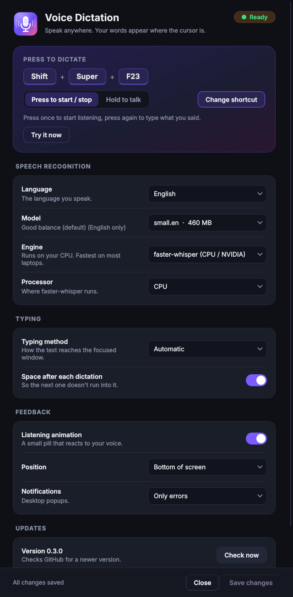

<p align="center">
  
</p>

<h1 align="center">whisper-dictate</h1>

<p align="center">
  <b>Press a key, speak, and your words appear wherever you're typing.</b><br>
  Local, private voice typing for Linux, powered by Whisper.
</p>

<p align="center">
  
</p>

System-wide voice typing for Linux. Press a shortcut in any app, speak, and
your words are typed into whatever window has focus. Speech recognition runs
**locally** with OpenAI's Whisper model, so nothing leaves your machine.

- Works on **Wayland and X11**: KDE Plasma, GNOME, Hyprland, Sway and others.
- **Hold-to-talk** or **toggle** (press to start, press again to stop).
- Uses your GPU when it can: **NVIDIA** through CUDA (faster-whisper),
  **AMD and Intel Arc** through Vulkan (whisper.cpp). Falls back to the CPU.
- A floating animation shows when it's listening (bars move with your voice)
  and when it's transcribing.
- A **Settings** window ("Voice Dictation" in your app menu): record a new
  shortcut, pick the language and model, switch hold/toggle, and update the app.
- English by default; switch language in Settings (needs a multilingual model).

## Screenshots

<p align="center">
  
</p>

The **Settings** window: record any shortcut by pressing it (the Copilot key
works), switch between toggle and hold-to-talk, pick the language and model,
and update the app.

<p align="center">
  
</p>

The on-screen pill: bars that move with your voice while it listens, then a
"Transcribing" spinner, then a check mark once the text is typed. It never
takes focus, so the text lands where your cursor is.

## Install (CachyOS / Arch)

```bash
git clone https://github.com/0XZEROX0/whisper-dictate
cd whisper-dictate
./install.sh
```

The installer:

1. Installs `portaudio ydotool wl-clipboard xdotool xclip libnotify` with pacman.
2. Adds you to the `input` group and adds a udev rule for `/dev/uinput`.
   This is what lets the app see the shortcut and type for you on Wayland.
3. Creates a Python environment in `~/.local/share/whisper-dictate/venv`,
   with CUDA libraries if it finds an NVIDIA GPU.
4. Installs and enables a systemd user service that starts with your desktop.

If it added you to the `input` group, **log out and back in once**.
Then run `whisper-dictate doctor` to check everything.

The first start downloads the Whisper model (about 480 MB for `small.en`).

### AMD or Intel GPU

faster-whisper only uses NVIDIA GPUs. On AMD or Intel Arc, install whisper.cpp
built with Vulkan (for example the AUR package `whisper.cpp-vulkan`), then:

```bash
whisper-dictate download-model          # fetches ggml-small.en.bin
systemctl --user restart whisper-dictate
```

With `engine.name = "auto"` the app uses whisper.cpp whenever `whisper-cli`
is installed and no NVIDIA GPU is present.

## Use

Default shortcut: **Ctrl+Alt+Space**. Change it in Settings: click the
shortcut button and press the keys you want. Single keys work too, such as
Right Ctrl, F9, or the **Copilot key** on newer laptops (it sends
Shift+Super+F23).

- **toggle** mode (default): press once, speak, press again.
- **hold** mode: hold the keys while you speak, let go to type.

While you speak, a small pill at the bottom of the screen shows moving bars;
then "Transcribing…", then a check mark when the text is typed. It never takes
focus, so the text still goes where your cursor is. Notifications only appear
for errors.

Other commands:

```
whisper-dictate toggle | start | stop | cancel | status
whisper-dictate settings    # open the Settings window
whisper-dictate update      # update to the latest version (--check to only look)
whisper-dictate doctor      # check your setup
whisper-dictate init-config # write the config file with comments
```

You can also bind `whisper-dictate toggle` to a key in your desktop's own
shortcut settings (KDE: System Settings > Shortcuts > Add Command) and set
`hotkey.combo = ""` to switch off the built-in listener.

## Configure

`~/.config/whisper-dictate/config.toml` (create it with `whisper-dictate init-config`):

```toml
[hotkey]
combo = "ctrl+alt+space"   # or "KEY_RIGHTCTRL", "super+h", "KEY_F9" ...
mode = "toggle"            # or "hold"

[engine]
name = "auto"              # "faster-whisper" or "whisper-cpp"
model = "small.en"         # tiny.en, base.en, small.en, medium.en, large-v3-turbo
device = "auto"            # faster-whisper: "cuda" or "cpu"

[feedback]
overlay = true             # floating listening animation
overlay_position = "bottom"
notifications = "errors"   # "errors", "all" or "off"

[output]
typer = "auto"             # ydotool, wtype, xdotool, clipboard
trailing_space = true
```

Restart after editing: `systemctl --user restart whisper-dictate`.

**Picking a model:** `small.en` is a good default on any recent CPU.
With a GPU, try `medium.en` or `large-v3-turbo` for better accuracy.
On a slow laptop use `base.en`.

## Updates

Settings checks for a new version each time it opens (you can turn that off),
and has a **Check for updates** button. Updating pulls the latest code from
GitHub into the folder you installed from, reinstalls it, and restarts the
background service. From a terminal: `whisper-dictate update`.

## How it works

| Part | Wayland | X11 |
|---|---|---|
| Shortcut | reads the keyboard through evdev (`/dev/input`) | same |
| Typing | `ydotool` (KDE, GNOME), `wtype` (Hyprland, Sway) | `xdotool` |
| Fallback | copy to clipboard and press Ctrl+V | same |

Wayland does not let normal apps grab global shortcuts or type into other
windows, so the app talks to the kernel's input layer instead. That works on
every desktop and is why the `input` group is needed.

## Troubleshooting

- **Nothing happens on the shortcut:** run `whisper-dictate doctor`. Usually
  you haven't logged out since joining the `input` group.
- **Text doesn't appear:** make sure ydotool's daemon runs:
  `systemctl --user enable --now ydotool`.
- **Hyprland / Sway don't start the service:** add
  `exec-once = systemctl --user start whisper-dictate` to your config.
- **Logs:** `journalctl --user -u whisper-dictate -f`

## Develop

```bash
python -m venv .venv && . .venv/bin/activate
pip install -e '.[dev,faster-whisper]'
pytest
whisper-dictate -v daemon
```

## License

MIT
