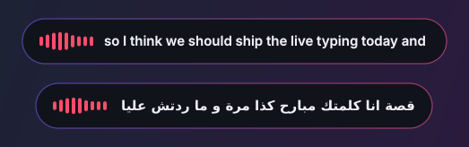
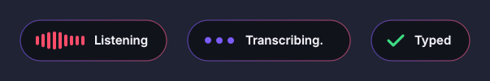

<p align="center">
  
</p>

<h1 align="center">whisper-dictate</h1>

<p align="center">
  <b>Press a key, speak, and your words appear wherever you're typing.</b><br>
  Local, private voice typing for Linux, powered by Whisper.
</p>

<p align="center">
  
</p>

System-wide voice typing for Linux. Press a shortcut in any app, speak, and
your words land in whatever text box has focus. Speech recognition runs
**locally** with OpenAI's Whisper models, so nothing leaves your machine.

- Works on **Wayland and X11**: GNOME, KDE Plasma, Hyprland, Sway and others.
- **Hold-to-talk** or **toggle** (press to start, press again to stop). Any
  shortcut works, including a single key or the **Copilot key**.
- **Several languages, a model for each.** It works out which of your
  languages you're speaking and uses that language's model, e.g. a fast
  English model plus a large **Egyptian Arabic** model.
- **Live typing:** words appear in the text box while you talk, or just in
  the floating bar if you prefer.
- **Pastes the whole text at once** (your clipboard is put back afterwards),
  and can press **Enter** for you to send a chat message.
- A floating bar shows when it's listening (bars move with your voice) and
  when it's transcribing.
- A **Settings** window ("Voice Dictation" in your app menu) that saves as you
  go, with download progress, a model manager, and built-in updates.
- Runs on the CPU out of the box; uses an **NVIDIA** GPU through CUDA, and
  **AMD / Intel Arc** through whisper.cpp + Vulkan if you set that up.

## Screenshots

<p align="center">
  
</p>

**Settings.** Record any shortcut by pressing it, switch toggle / hold, pick
the languages to detect and a model for each, turn on live typing, and manage
downloaded models. Changes save automatically.

<p align="center">
  
</p>

**Live text** in the floating bar, in English or Arabic (right to left). It
never takes focus, so your text still lands where your cursor is.

<p align="center">
  
</p>

Listening, transcribing, done.

<p align="center">
  
</p>

It glides in from the screen edge it sits on (top or bottom) with a little
bounce, and when you're done it dips and slides back out.

## Install

Tested on **CachyOS / Arch Linux**. Other distributions work too; install
the packages from step 1 with your package manager.

**1. Download and run the installer**

```bash
git clone https://github.com/0XZEROX0/whisper-dictate
cd whisper-dictate
./install.sh
```

It asks for your password once (for `sudo`) and then:

- installs `python portaudio ydotool wl-clipboard xdotool xclip libnotify`
  with pacman,
- adds you to the `input` group and a udev rule for `/dev/uinput`, which is
  what lets the app see your shortcut and type for you on Wayland,
- creates its own Python environment in `~/.local/share/whisper-dictate/venv`
  (with CUDA libraries if it finds an NVIDIA GPU),
- adds **Voice Dictation** to your app menu and a background service that
  starts with your desktop.

**2. Log out and back in** (only the first time), so the `input` group takes
effect.

**3. Check it**

```bash
whisper-dictate doctor
```

Every line should say OK. If something isn't, the line tells you what to do.

**4. Dictate.** Click into any text box, press **Ctrl+Alt+Space**, speak, and
press it again. The first time, the speech model downloads (about 480 MB for
English); the floating bar and Settings show the progress.

**5. Make it yours.** Open **Voice Dictation** from your app menu to change
the shortcut, add languages, turn on live typing, and so on.

**Update** later from Settings (it checks when it opens) or with
`whisper-dictate update`. **Uninstall** with `./uninstall.sh`.

### Arabic, other languages and dialects

In Settings, set **Language** to *Detect automatically*, add your languages,
and pick a model for each. For a dialect, a fine-tuned model is far better
than the general one. For Egyptian Arabic:

```bash
whisper-dictate add-model egyptian-turbo   # converts it once (needs: pip install transformers torch)
```

then choose **Egyptian Arabic** as the Arabic model. A ready CTranslate2 model
folder copied into `~/.local/share/whisper-dictate/models/<name>/` shows up
as well.

### AMD or Intel GPU

faster-whisper only uses NVIDIA GPUs. On AMD or Intel Arc, install whisper.cpp
built with Vulkan (for example the AUR package `whisper.cpp-vulkan`), then:

```bash
whisper-dictate download-model          # fetches ggml-small.en.bin
systemctl --user restart whisper-dictate
```

and pick **whisper.cpp (GPU)** as the engine in Settings. "Automatic" always
uses faster-whisper, because on laptop GPUs whisper.cpp is often slower than
faster-whisper on the CPU (on an Intel Arc 140T: 2.0 s vs 1.2 s for an 11 s
clip). Compare both on your machine.

## Use

Default shortcut: **Ctrl+Alt+Space**. Change it in Settings: click the
shortcut button and press the keys you want. Single keys work too, such as
Right Ctrl, F9, or the **Copilot key** on newer laptops (it sends
Shift+Super+F23).

- **toggle** mode (default): press once, speak, press again.
- **hold** mode: hold the keys while you speak, let go to type.

While you speak, a small bar at the bottom of the screen shows moving bars;
then "Transcribing…", then a check mark when the text is in. It never takes
focus, so the text still goes where your cursor is. Notifications only appear
for errors.

**Live transcription** (Settings > Typing): *Type as I speak* puts words into
the text box while you talk (a phrase is finished each time you pause);
*Show in the floating bar* only previews them and inserts the text when you
stop. On a CPU, large models such as the Egyptian Arabic one run a few seconds
behind you; small English models keep up.

Other commands:

```
whisper-dictate toggle | start | stop | cancel | status
whisper-dictate settings    # open the Settings window
whisper-dictate update      # update to the latest version (--check to only look)
whisper-dictate doctor      # check your setup
whisper-dictate init-config # write the config file with comments
```

You can also bind `whisper-dictate toggle` to a key in your desktop's own
shortcut settings (KDE: System Settings > Shortcuts > Add Command) and set
`hotkey.combo = ""` to switch off the built-in listener.

## Configure

`~/.config/whisper-dictate/config.toml` (create it with `whisper-dictate init-config`):

```toml
[hotkey]
combo = "ctrl+alt+space"   # or "KEY_RIGHTCTRL", "super+h", "KEY_F9" ...
mode = "toggle"            # or "hold"

[engine]
name = "auto"              # "faster-whisper" or "whisper-cpp"
model = "small.en"         # tiny.en, base.en, small.en, medium.en, large-v3-turbo
device = "auto"            # faster-whisper: "cuda" or "cpu"

[feedback]
overlay = true             # floating listening animation
overlay_position = "bottom"
notifications = "errors"   # "errors", "all" or "off"

[output]
typer = "auto"             # ydotool, wtype, xdotool, clipboard
trailing_space = true
press_enter = false        # press Enter after typing (send a chat message)
paste = true               # insert all at once (clipboard is restored)
live = "off"               # "type": words go into the text box as you talk
                           # "preview": words show in the floating bar
```

The Settings window saves changes as you make them. If you edit the file by
hand, restart afterwards: `systemctl --user restart whisper-dictate`.

**Picking a model:** `small.en` is a good default on any recent CPU.
With a GPU, try `medium.en` or `large-v3-turbo` for better accuracy.
On a slow laptop use `base.en`.

**Several languages:** set Language to *Detect automatically* in Settings and
add the languages you speak, each with its own model. The app then only
chooses between those (far more reliable than open detection) and uses that
language's model, so English can stay fast while a harder language like
Arabic gets `large-v3-turbo`:

```toml
[engine]
language = "auto"

[languages]
detect = ["en", "ar"]
models = { "en" = "small.en", "ar" = "large-v3-turbo" }
```

**Dialects and fine-tuned models:** `add-model egyptian-turbo` (Egyptian
Arabic, keeps English words in English), `add-model arabic-dialects-turbo`
(several Arabic dialects), or `add-model <hugging-face-repo-id>` for any
Whisper fine-tune.

**Models on disk:** Settings lists every downloaded model with its size;
delete the ones you don't use, or cancel a download in progress.

## Updates

Settings checks for a new version each time it opens (you can turn that off),
and has a **Check for updates** button. Updating pulls the latest code from
GitHub into the folder you installed from, reinstalls it, and restarts the
background service. From a terminal: `whisper-dictate update`.

## How it works

| Part | Wayland | X11 |
|---|---|---|
| Shortcut | reads the keyboard through evdev (`/dev/input`) | same |
| Typing | `ydotool` (KDE, GNOME), `wtype` (Hyprland, Sway) | `xdotool` |
| Fallback | copy to clipboard and press Ctrl+V | same |

Wayland does not let normal apps grab global shortcuts or type into other
windows, so the app talks to the kernel's input layer instead. That works on
every desktop and is why the `input` group is needed.

## Troubleshooting

- **Nothing happens on the shortcut:** run `whisper-dictate doctor`. Usually
  you haven't logged out since joining the `input` group.
- **Text doesn't appear:** make sure ydotool's daemon runs:
  `systemctl --user enable --now ydotool`.
- **Hyprland / Sway don't start the service:** add
  `exec-once = systemctl --user start whisper-dictate` to your config.
- **A model download is stuck at 0 bytes:** the app turns off Hugging Face's
  Xet downloader, which can stall; if you download by hand, set
  `HF_HUB_DISABLE_XET=1`.
- **Nothing is pasted in a terminal:** terminals paste with Ctrl+Shift+V.
  Turn off *Insert all at once* in Settings so text is typed instead.
- **Logs:** `journalctl --user -u whisper-dictate -f`

## Develop

```bash
python -m venv .venv && . .venv/bin/activate
pip install -e '.[dev,faster-whisper]'
pytest
whisper-dictate -v daemon
```

## License

MIT
